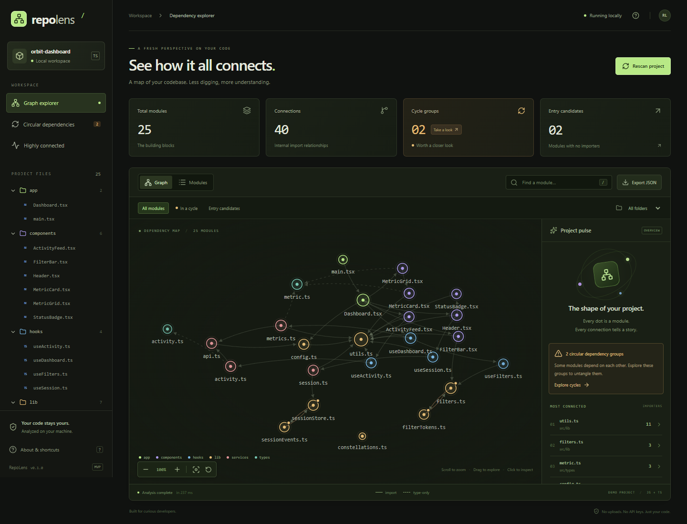

# RepoLens

English | [Русский](README.ru.md)

**See how your code connects.**

A local-first dependency explorer for JavaScript and TypeScript. Turn a project into an interactive map, follow imports, and spot circular dependencies without uploading your code.

No accounts. No API keys. No project code execution.



## Quick start

Requires **Node.js 22.12+** and **npm**. Clone or download this repository, open a terminal in its root directory, and run:

```bash
npm ci
npm run build
npm run demo
```

Open **[http://127.0.0.1:4173](http://127.0.0.1:4173)** in your browser. Stop the server with `Ctrl+C` in the terminal where you started it.

This is a **local demo**, not a hosted service. The MVP runs from a source checkout; it is not published to npm.

## Try the demo

The included [Orbit Dashboard fixture](demo/) has **25 modules, 40 internal connections, and 2 intentional cycle groups**.

1. Select `utils.ts` to see which 11 modules import it.
2. Choose **In a cycle** to isolate the four modules in the two circular dependency groups.
3. Search for `session` or filter by folder to narrow the graph.
4. Switch to **Modules** to sort files by incoming imports, outgoing imports, or line count.
5. Click **Export JSON** to download the full graph, regardless of the current filters.

Scroll to zoom, drag the background to pan, or drag individual nodes to rearrange them. The demo is an analysis fixture, not a separately runnable dashboard application.

## Analyze your own project

After building RepoLens, run these commands from the RepoLens repository root, replacing the example path with your project's directory:

```bash
npm start -- "/path/to/your-project"
```

Windows paths are supported; quote paths containing spaces:

```powershell
npm start -- "C:/Users/you/Projects/my-app"
```

If the demo is still running on the default port, use another port:

```bash
npm start -- "/path/to/your-project" --port 4174
```

Then open [http://127.0.0.1:4174](http://127.0.0.1:4174). You do not need to install RepoLens inside the project you are analyzing.

Click **Rescan project** after changing files. Scans are manual; the MVP does not watch the project for changes.

## What you can explore

- **Interactive graph:** directed imports, folder colors, zoom, pan, and draggable nodes.
- **Module details:** incoming and outgoing dependencies, exports, external packages, unresolved local imports, file sizes, and line counts.
- **Circular dependencies:** strongly connected module groups, including self-imports.
- **Highly connected modules:** files with at least three importers.
- **Entry candidates:** files with no importers, including isolated modules.
- **Search and filters:** case-insensitive path search, folder selection, and cycle or entry filters.
- **JSON export:** save the full dependency graph from the browser or CLI.

### Reading the graph

Each node is a file; larger nodes have more connections. An arrow points **from the importing file to the file it imports**. Dashed edges represent type-only imports, and amber dots mark modules in a cycle group.

Cycle groups include **type-only** relationships, so a reported cycle is not necessarily a runtime problem. A group can contain multiple overlapping cycles. Entry candidates are based only on incoming imports; they are not inferred application entry points.

| Shortcut          | Action                                                |
| ----------------- | ----------------------------------------------------- |
| `/`               | Focus module search                                   |
| `Esc`             | Clear search and selection, or close the About dialog |
| `Enter` / `Space` | Inspect a keyboard-focused graph node                 |

## CLI

Use the built CLI directly or pass options through `npm start --`:

```bash
node dist/server/cli.js [directory] [options]
```

| Option          | Description                                                        |
| --------------- | ------------------------------------------------------------------ |
| `[directory]`   | Project directory; defaults to the CLI process's working directory |
| `--demo`        | Analyze the included demo instead of a project directory           |
| `--port <port>` | Local server port; defaults to `4173`                              |
| `--json`        | Print the graph as JSON and exit without starting a server         |
| `-h`, `--help`  | Show CLI help                                                      |

Do not combine a project directory with `--demo`.

For machine-readable output, invoke Node directly so npm's command banners do not appear in the JSON:

```bash
node dist/server/cli.js "/path/to/your-project" --json > graph.json
```

## Development

```bash
npm ci
npm run dev
```

The development command serves the demo at [http://127.0.0.1:4173](http://127.0.0.1:4173) without requiring a production build. Refresh the browser after UI edits; hot module replacement is currently disabled. Restart the command after server-side edits.

```bash
npm run check
npm test
npm run build
```

Browser regression tests start their own production demo on **port 4180**, which must be free:

```bash
npx playwright install chromium
npm run test:ui
```

Alternatively, use an existing Google Chrome installation without downloading Playwright's Chromium.

Bash:

```bash
PLAYWRIGHT_CHANNEL=chrome npm run test:ui
```

PowerShell:

```powershell
$env:PLAYWRIGHT_CHANNEL = "chrome"
npm run test:ui
Remove-Item Env:PLAYWRIGHT_CHANNEL
```

The tests cover import resolution, cycle detection, CLI behavior, local server protections, graph interactions, filtering, JSON downloads, error recovery, and mobile layout.

### Project layout

```text
src/server/   TypeScript-based analyzer, local HTTP server, and CLI
src/shared/   Shared graph types
src/web/      React interface and D3-powered SVG graph
demo/         Sample project with intentional dependency cycles
tests/        Unit, integration, and Playwright browser tests
```

## Current scope and limitations

- Analyzes `.js`, `.jsx`, `.ts`, `.tsx`, `.mjs`, `.cjs`, `.mts`, and `.cts` files, including TypeScript declaration files.
- Recognizes static imports, re-exports, literal dynamic imports, literal `require()` calls, and type-only imports.
- Resolves relative paths and aliases from the nearest `tsconfig.json` or `jsconfig.json`. Bundler-only aliases and computed import paths are not resolved.
- Honors **only the root `.gitignore`**. Skips symlinks, `node_modules`, common build/output directories, and non-code assets such as stylesheets and images.
- External packages are listed in module details, not expanded into graph nodes. CommonJS dependencies are detected, but the exports list describes ES/TypeScript exports, not `module.exports` assignments.
- This is a static import map, not a call graph, dead-code analyzer, or runtime dependency profiler. Framework conventions and implicit entry points are not inferred.
- The SVG view is intended for small-to-medium projects; very large repositories have not been benchmarked.

## Privacy

Analysis runs on your machine and never executes the target project's code. The server binds to `127.0.0.1` and rejects unexpected hosts and cross-origin requests. There is no telemetry, cloud backend, or API-key requirement. Normal scans do not contact external services; installing dependencies or test browsers requires downloads.

Exported JSON includes project and file names, export symbols, and dependency metadata. Review it before sharing it publicly.

## Troubleshooting

- **`EADDRINUSE`:** stop the other server or choose a free port with `--port 4174`.
- **Missing `dist/server/cli.js`:** run `npm run build` before `npm start`, `npm run demo`, or direct CLI commands.
- **Empty graph:** check that the selected directory contains supported files and they are not excluded by `.gitignore` or the built-in directory exclusions.
- **Unresolved imports:** check your TypeScript/JavaScript path aliases. Computed imports and bundler-only resolution are outside the MVP's scope.
