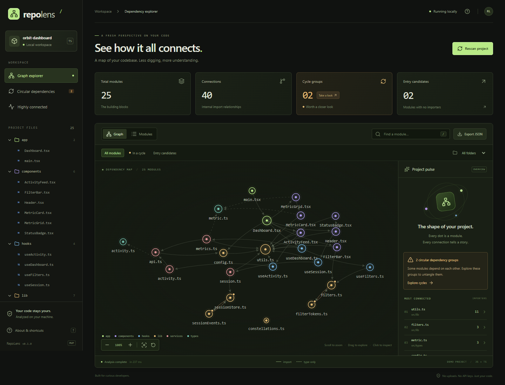

# RepoLens

[English](README.md) | Русский

**Узнайте, как связаны файлы вашего проекта.**

Локальный инструмент для исследования зависимостей в JavaScript и TypeScript. Превратите проект в интерактивную карту, проследите импорты и найдите циклические зависимости, не загружая код на сторонние серверы.

Без аккаунтов. Без API-ключей. Без выполнения кода анализируемого проекта.



## Быстрый старт

Понадобятся **Node.js 22.12+** и **npm**. Клонируйте или скачайте этот репозиторий, откройте терминал в его корневой папке и выполните:

```bash
npm ci
npm run build
npm run demo
```

Откройте **[http://127.0.0.1:4173](http://127.0.0.1:4173)** в браузере. Чтобы остановить сервер, нажмите `Ctrl+C` в терминале, где он запущен.

Это **локальное демо**, а не размещённый в интернете сервис. MVP запускается из исходников; пакет ещё не опубликован в npm.

## Попробуйте демо

Встроенный [демопроект Orbit Dashboard](demo/) содержит **25 модулей, 40 внутренних связей и 2 намеренно созданные группы циклических зависимостей**.

1. Выберите `utils.ts`, чтобы увидеть 11 модулей, которые его импортируют.
2. Нажмите **In a cycle**, чтобы оставить на графе четыре модуля из двух групп циклических зависимостей.
3. Найдите `session` или выберите папку, чтобы сузить область просмотра.
4. Переключитесь на **Modules**, чтобы отсортировать файлы по количеству входящих импортов, исходящих импортов или строк кода.
5. Нажмите **Export JSON**, чтобы скачать полный граф независимо от текущих фильтров.

Прокручивайте колесо мыши для масштабирования, перетаскивайте фон для перемещения по графу или отдельные узлы для изменения их расположения. Демопроект — пример кода для анализа, а не самостоятельное приложение с панелью управления.

## Проанализируйте свой проект

После сборки RepoLens выполните команду из корня его репозитория, заменив пример пути на папку вашего проекта:

```bash
npm start -- "/path/to/your-project"
```

Пути Windows тоже поддерживаются. Заключайте пути с пробелами в кавычки:

```powershell
npm start -- "C:/Users/you/Projects/my-app"
```

Если демо всё ещё работает на стандартном порту, выберите другой:

```bash
npm start -- "/path/to/your-project" --port 4174
```

Затем откройте [http://127.0.0.1:4174](http://127.0.0.1:4174). Устанавливать RepoLens внутрь анализируемого проекта не нужно.

После изменения файлов нажмите **Rescan project**. Повторное сканирование запускается вручную: MVP не отслеживает изменения файлов автоматически.

## Что можно исследовать

- **Интерактивный граф:** направленные связи импортов, цвета папок, масштабирование, перемещение по графу и перетаскивание узлов.
- **Информация о модулях:** входящие и исходящие зависимости, экспорты, внешние пакеты, неразрешённые локальные импорты, размеры файлов и количество строк.
- **Циклические зависимости:** сильно связанные группы модулей, включая импорт файла из самого себя.
- **Модули с большим числом связей:** файлы, импортируемые как минимум тремя другими модулями.
- **Кандидаты в точки входа:** файлы, которые никто не импортирует, включая изолированные модули.
- **Поиск и фильтры:** поиск по пути без учёта регистра, выбор папки и фильтры циклов или кандидатов в точки входа.
- **Экспорт JSON:** сохранение полного графа зависимостей из браузера или CLI.

### Как читать граф

Каждый узел — файл; чем больше у него связей, тем крупнее узел. Стрелка направлена **от импортирующего файла к файлу, который он импортирует**. Пунктирные связи обозначают импорты только типов, а янтарные точки отмечают модули, входящие в группу циклических зависимостей.

При поиске циклов учитываются связи **только между типами**, поэтому обнаруженный цикл не обязательно означает проблему во время выполнения. Одна группа может содержать несколько пересекающихся циклов. Кандидаты в точки входа определяются только по отсутствию входящих импортов: инструмент не устанавливает фактические точки входа приложения.

| Сочетание клавиш  | Действие                                                                 |
| ----------------- | ------------------------------------------------------------------------ |
| `/`               | Перейти к поиску модулей                                                 |
| `Esc`             | Очистить поиск и выделение или закрыть окно About                        |
| `Enter` / `Space` | Открыть информацию об узле графа, на котором установлен фокус клавиатуры |

## CLI

Запускайте собранный CLI напрямую или передавайте параметры через `npm start --`:

```bash
node dist/server/cli.js [directory] [options]
```

| Параметр        | Описание                                                           |
| --------------- | ------------------------------------------------------------------ |
| `[directory]`   | Папка проекта; по умолчанию — рабочая папка процесса CLI           |
| `--demo`        | Анализ встроенного демопроекта вместо указанной папки              |
| `--port <port>` | Порт локального сервера; по умолчанию — `4173`                     |
| `--json`        | Вывести граф в формате JSON и завершить работу без запуска сервера |
| `-h`, `--help`  | Показать справку CLI                                               |

Не указывайте папку проекта одновременно с `--demo`.

Для получения машиночитаемого вывода запускайте Node напрямую, чтобы служебные сообщения npm не попали в JSON:

```bash
node dist/server/cli.js "/path/to/your-project" --json > graph.json
```

## Разработка

```bash
npm ci
npm run dev
```

Команда запускает демо по адресу [http://127.0.0.1:4173](http://127.0.0.1:4173) без предварительной производственной сборки. После правок интерфейса обновляйте страницу: горячая замена модулей (HMR) сейчас отключена. После изменения серверного кода перезапустите команду.

```bash
npm run check
npm test
npm run build
```

Браузерные регрессионные тесты запускают собственный сервер демо из производственной сборки на **порту 4180**. Этот порт должен быть свободен:

```bash
npx playwright install chromium
npm run test:ui
```

Вместо загрузки Chromium для Playwright можно использовать уже установленный Google Chrome.

Bash:

```bash
PLAYWRIGHT_CHANNEL=chrome npm run test:ui
```

PowerShell:

```powershell
$env:PLAYWRIGHT_CHANNEL = "chrome"
npm run test:ui
Remove-Item Env:PLAYWRIGHT_CHANNEL
```

Тесты проверяют разрешение импортов, обнаружение циклов, поведение CLI, защитные проверки локального сервера, взаимодействие с графом, фильтрацию, скачивание JSON, восстановление после ошибок и мобильную вёрстку.

### Структура проекта

```text
src/server/   Анализатор на TypeScript, локальный HTTP-сервер и CLI
src/shared/   Общие типы графа
src/web/      Интерфейс на React и SVG-граф на D3
demo/         Пример проекта с намеренными циклическими зависимостями
tests/        Модульные, интеграционные и браузерные тесты Playwright
```

## Возможности и ограничения текущей версии

- Анализируются файлы `.js`, `.jsx`, `.ts`, `.tsx`, `.mjs`, `.cjs`, `.mts` и `.cts`, включая файлы деклараций TypeScript.
- Распознаются статические импорты, реэкспорты, динамические импорты и вызовы `require()` с явно заданными строковыми путями, а также импорты только типов.
- Разрешаются относительные пути и алиасы из ближайшего `tsconfig.json` или `jsconfig.json`. Алиасы, заданные только в сборщике, и вычисляемые пути импортов не разрешаются.
- Учитывается **только корневой `.gitignore`**. Пропускаются символические ссылки, `node_modules`, распространённые папки сборки и вспомогательные ресурсы, например стили и изображения.
- Внешние пакеты отображаются в информации о модуле, но не становятся узлами графа. Зависимости CommonJS обнаруживаются, однако список экспортов отражает экспорты ES/TypeScript, а не присваивания `module.exports`.
- Это статическая карта импортов, а не граф вызовов, анализатор неиспользуемого кода или профилировщик зависимостей во время выполнения. Соглашения фреймворков и неявные точки входа не определяются.
- SVG-представление предназначено для небольших и средних проектов; производительность на очень больших репозиториях пока не измерялась.

## Конфиденциальность

Анализ выполняется на вашем компьютере и никогда не запускает код целевого проекта. Сервер слушает только `127.0.0.1` и отклоняет запросы с неожиданным заголовком Host или чужим источником Origin. Телеметрии, облачного бэкенда и требования API-ключей нет. Обычное сканирование не обращается к внешним сервисам; установка зависимостей или браузеров для тестов требует скачивания файлов.

Экспортированный JSON содержит названия проекта и файлов, имена экспортируемых сущностей и метаданные зависимостей. Проверьте его содержимое перед публичной публикацией.

## Решение проблем

- **`EADDRINUSE`:** остановите другой сервер или выберите свободный порт с помощью `--port 4174`.
- **Отсутствует `dist/server/cli.js`:** выполните `npm run build` перед `npm start`, `npm run demo` или прямым запуском CLI.
- **Пустой граф:** убедитесь, что выбранная папка содержит поддерживаемые файлы и они не исключены правилами `.gitignore` или встроенным списком пропускаемых папок.
- **Неразрешённые импорты:** проверьте алиасы путей TypeScript/JavaScript. Вычисляемые импорты и разрешение путей только средствами сборщика не входят в возможности MVP.
